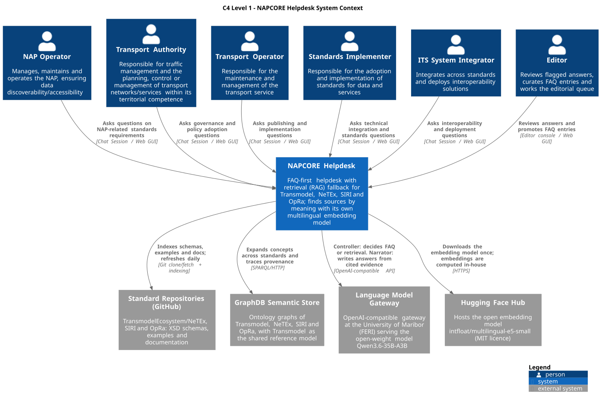

# NAPCORE Helpdesk

NAPCORE Helpdesk is a FAQ-first, RAG-fallback helpdesk for transport standards.
It answers user questions from approved standards repositories, provides evidence and citations, and supports a human editorial workflow before publication.

## What this repository contains

- Backend API and orchestration: Django + DRF
- Frontend web GUI: React + TypeScript + Vite
- Retrieval stack: lexical + vector retrieval (pgvector in PostgreSQL), with semantic embeddings from a self-hosted multilingual model (intfloat/multilingual-e5-small)
- Optional graph expansion: GraphDB (RDF/OWL + SPARQL)
- Editorial workflow: draft -> review -> approved/rejected -> published

## Architecture at a glance

The runtime uses a split LLM path:

- Controller path: intent detection, route selection, and constrained query planning
- Narration path: grounded answer composition from evidence and citations

_Figure: C4 Level 1 system context._

Essential architecture doc:

- [Architecture overview](docs/architecture-overview.md)

## Quickstart

Install guides:

- [Installation (local and Docker)](docs/installation.md)

## Make targets

- `make help`

## Documentation

Documentation index:

- [Documentation index](docs/README.md)

## Contributing

Contribution workflow and checks are documented in:

- [CONTRIBUTING.md](CONTRIBUTING.md)

## Production

- [https://kgpi.fgpa.um.si/napcore-helpdesk/](https://kgpi.fgpa.um.si/napcore-helpdesk/)

## License

Copyright (C) 2026 University of Maribor, Faculty of Civil Engineering,
Transportation Engineering and Architecture, Chair of Construction and
Transportation Informatics (KGPI).

The NAPCORE Helpdesk source code is free software: you can redistribute it
and/or modify it under the terms of the GNU Affero General Public License,
version 3 only (AGPL-3.0-only), as published by the Free Software Foundation.
It is distributed in the hope that it will be useful, but WITHOUT ANY
WARRANTY; without even the implied warranty of MERCHANTABILITY or FITNESS FOR
A PARTICULAR PURPOSE. See the [LICENSE](LICENSE) file for the full text.

If you run a modified version that users reach over a network, section 13 of
the license requires you to offer those users the source code of your version.

### Additional terms (AGPL-3.0, section 7)

1. **Author attribution** (section 7(b)). Any copy or modified version that
   displays an "About" page or comparable user-visible information must keep
   the notice "Originally developed by the University of Maribor, Chair of
   Construction and Transportation Informatics (KGPI)", with a link to
   <https://kgpi.fgpa.um.si/>.
2. **No misrepresentation of origin** (section 7(c)). Modified versions must
   be marked as changed and must not be presented as the original NAPCORE
   Helpdesk or as endorsed by the University of Maribor.
3. **Names and marks** (section 7(e)). This license grants no right to use
   the names or logos of the University of Maribor, its Faculty of Civil
   Engineering, Transportation Engineering and Architecture, or KGPI to
   promote derived works.

### Third-party content

The license above covers the Helpdesk's own code. Content derived from or
copied from other sources (for example NeTEx and OpRa definitions, GPL-3.0;
SIRI and Transmodel, CEN; EU legislation from EUR-Lex; pages and documents
from napcore.eu) remains under its original terms.
