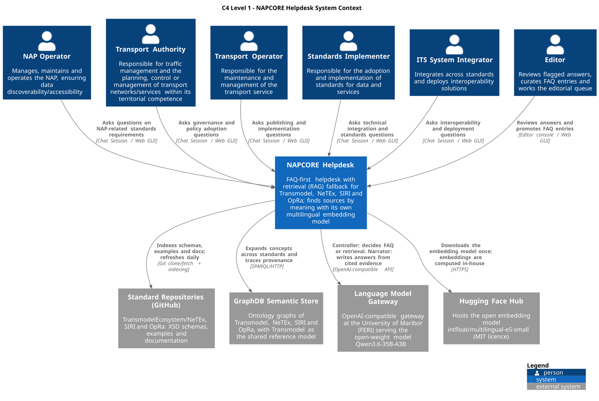

# Project Background

> **Work in progress:** NAPCORE Helpdesk is under active development and currently in pilot testing. Answers may be incomplete or occasionally inaccurate. Always check them against the cited sources and the official standard documentation. Coverage, features, and behaviour may change between releases, and your feedback directly shapes what comes next. The work is part of the NAPCORE Task 4.3 Multimodal standards, with active contributions from task members.

This page covers where NAPCORE Helpdesk idea came from, who defined it, and how it was
built. For what the system does and how it's structured today, see
[Architecture overview](architecture-overview.md); for a running log of feature
changes, see [Recent updates](recent-updates.md).

## Purpose

NAPCORE Helpdesk helps implementers get reliable answers to their questions
about the European public transport data standards Transmodel, NeTEx, SIRI,
and OpRa, and about the EU legislation that governs their data: the MMTIS
Delegated Regulation (EU) 2017/1926, the ITS Directive 2010/40/EU and the
TEL TSI (EU) 2026/253.

- **Grounded answers:** responses are based only on approved source
  repositories and the official EU legal texts, and cite the evidence they
  use. A Transmodel definition links to its class page in the Transmodel model
  (with its package and diagrams), and a legal answer links to the article on
  EUR-Lex.
- **Semantic technologies:** the standards are modelled as linked data and
  stored in a GraphDB knowledge graph, with Transmodel as the shared reference
  model, helping the assistant find related concepts across standards. The
  terms the EU acts define form a vocabulary generated from the acts, linked
  to the standards the acts name.
- **Structure-aware answers:** how two concepts are related (for example a
  LINE, its ROUTEs and the JOURNEY PATTERNs on them) and what two schemas have
  in common are computed from the standards' own structure, refreshed with
  every update of the source repositories, and cited as evidence.
- **Legal context:** answers about NeTEx, SIRI or Transmodel list the
  provisions of the EU acts that name the standard, and questions about a
  standard's legal status (for example whether it is mandatory) are answered
  from those provisions.
- **AI as controller and narrator:** a controller model checks whether a
  matched FAQ fits or the sources should be searched, and a narration model
  writes the answer from the retrieved evidence. Both use the open-weight model
  `nvidia/Qwen3.6-35B-A3B-NVFP4`, hosted at the University of Maribor, Faculty
  of Electrical Engineering and Computer Science.
- **Honest about gaps:** when the evidence is insufficient, the assistant says
  so instead of guessing.
- **Curated knowledge:** editorially reviewed FAQ answers are used
  first, with search across the source repositories as a fallback.
- **Your language:** ask in any supported language and get the answer in the
  same language, so working in English is not required. Sources are found by
  meaning, with a multilingual embedding model, not only by shared words.

The name refers to NAPCORE, the EU coordination initiative for National Access
Points to transport data, which these standards serve (www.napcore.eu).

## System context

Who uses the helpdesk and which external systems it relies on (C4 model, level 1).

## Requirements & design

The requirements and domain design are by:

- Andrej Tibaut
- Sara Guerra de Oliveira

both affiliated with University of Maribor
Faculty of Civil Engineering,
Transportation Engineering and Architecture,
Chair of Construction and Transportation Informatics (https://kgpi.fgpa.um.si/). They defined the scope (the standards NeTEx/SIRI/OpRa/
Transmodel and, since November 2026, the EU legislation that governs their
data: MMTIS, the ITS Directive and the TEL TSI), the FAQ-first/RAG-fallback
answer strategy, the citation and abstention rules, and the editorial review
workflow. The work is part of NAPCORE Task 4.3 Multimodal standards, led by Jorge Gonzalez, Multimodal and Digital Policy Officer at the French Ministry of Transport (DGITM). Active task partners are contributing during the pilot phase.

Collaborators who joined recently make important contributions to the
requirements and to testing:

- David Ariño-Montoya
- Thibaut Barrère
- Valentina Carriero
- Nenad Čuš Babič
- Christophe Duquesne
- Brewenn Métayer
- Mario Scrocca
- Tu-Tho Thai

## Development approach

Development is led by Andrej Tibaut, who orchestrates the implementation and also
contributes directly to the code. AI-assisted coding tools support the
day-to-day work. As the commit history shows, development has been iterative
rather than planned in full up front:

- Small, scoped, conventionally-named commits (`feat(...)`, `fix(...)`,
  `chore(...)`, `docs(...)`).
- CI quality gates (backend tests, OpenAPI schema, C4 diagram checks, Postgres
  integration, a retrieval benchmark that fails when answer evidence gets
  worse, and an nginx configuration check) were added early and extended alongside features rather than
  bolted on at the end.
- Fixes and reverts follow closely behind features shipped to real usage
  (e.g. the deep-link, spell-check, and GraphRAG definition-retrieval work),
  reflecting a "ship, observe, correct quickly" loop rather than long
  pre-verification cycles.

## Timeline (from git history)

The project started on 2026-03-28 and has had continuous, active development
since. Broad phases, in order:

1. **Foundations** (Mar 2026): initial project import; hybrid lexical+vector
   retrieval on PostgreSQL/pgvector; FAQ and RAG persistence and editorial
   RBAC scaffolding aligned to the C4 architecture.
2. **Ontology, GraphRAG & editorial maturation** (Apr to Jun 2026):
   XSD-to-ontology extraction pipeline and GraphDB-backed concept expansion;
   FAQ-first/RAG-fallback answer strategy; the editorial draft → review →
   approved/rejected → published workflow, KPI widgets, and board UI; Fedora
   VM + Docker Compose deployment automation.
3. **Answer-quality & reasoning-model hardening** (Jul 2026, the single
   largest push, about 40% of all commits to date): citation-grounding
   correctness (stop false rejections, prevent hallucinated [E#] references,
   lenient handling for code blocks); Qwen reasoning-model controller
   tuning; prompt-constraint and markdown-formatting fixes; multilingual
   abstain/insufficient-evidence phrasing.
4. **UI/UX refinement & release cadence** (Jul 2026, ongoing): user
   discovery features (Inspiring questions panel with smart caching);
   streamlined version display and deep-linking to individual Q&A
   exchanges; frequent patch releases; C4 diagram maintenance;
   Dependabot/security fixes; community contribution pathway via GitHub.
5. **Cross-standard ontology alignment & robustness** (Sep 2026, ongoing):
   migrated NeTEx/OpRa/SIRI source repositories to their current
   canonical GitHub orgs and reindexed; rewrote stale ontology alignments
   (825 NeTEx, 297 SIRI, 102 OpRa concepts now correctly mapped to a
   shared core ontology, since replaced by Transmodel); fixed the GraphDB query structure that had
   silently prevented cross-standard concept expansion from ever working;
   corrected a production LLM model-alias regression and built a
   self-healing recovery mechanism, plus a public, browser-viewable LLM
   status endpoint, to make gateway drift visible instead of silently
   breaking answers; closed drift between the API and its documentation (OpenAPI
   spec, endpoint reference); dependency upgrades (React Router v7,
   Vitest v4).
6. **Transmodel pivot & structure-aware answers** (Oct 2026, ongoing):
   replaced the separate core ontology with Transmodel as the single
   cross-standard reference and dropped DATEX II from scope; relation paths
   between concepts, with longer chains chosen where Transmodel's own
   definitions document each step; service abbreviations (e.g. SIRI-CA,
   SIRI-VM) read from the standards' READMEs and shared schema structure
   computed for comparison questions; matching everyday wording to model
   terms (e.g. "charging station" for RECHARGING STATION); stricter checks
   that claims about an element's purpose are grounded in a definition; a
   daily refresh of all indexed repositories at their real commits, and the
   standard ontologies regenerated from upstream with a weekly drift check;
   a maintenance page during deploys; faster and sturdier answers, with
   retrieval in about half the time and a stream that reports progress from
   the start, so long answers no longer time out; since 27 October, sources
   are found by meaning with a multilingual embedding model
   (multilingual-e5-small) running in the helpdesk's own embedding service.
   Collaborators recently joined and contribute to the requirements and
   testing.
7. **EU legislation & linked source models** (Nov 2026, ongoing): the
   Transmodel model published as an Enterprise Architect HTML export, with
   each Transmodel definition in an answer linking to its class page (package
   and diagrams) by the class's EA GUID; the EU legislation added as a source:
   MMTIS, the ITS Directive and the TEL TSI from the EU Publications Office,
   as consolidated texts together with the amending acts, quoted by article
   and linked to EUR-Lex; a vocabulary of the 97 terms the acts define,
   generated from their definitions articles, so questions such as "What is
   static travel data?" reach the legislation; questions about a standard's
   legal status answered from the provisions that name it, and a Legal
   context line under answers about NeTEx, SIRI and Transmodel.

See [Recent updates](recent-updates.md) for a detailed log of the latest
phase. Development is ongoing, and this timeline will grow as the project
evolves.

## Contributing

NAPCORE Helpdesk is developed collaboratively, and feedback from the
community is very welcome. Because the project is a work in progress, reports
of incorrect, incomplete, or missing answers are especially valuable: use the
thumbs up and thumbs down buttons under each answer. The
[GitHub repository](https://github.com/UM-KGPI/NapcoreHelpdesk) is currently
private; NAPCORE task members can ask Andrej Tibaut or Sara Guerra de Oliveira
for access, and collaborators can there report issues, propose features,
submit pull requests, or review the codebase and architecture. See [Contributing](../CONTRIBUTING.md) for development flow and
commit conventions.

## License

Originally developed by the University of Maribor, Chair of Construction and
Transportation Informatics (KGPI) ([kgpi.fgpa.um.si](https://kgpi.fgpa.um.si/)).
The source code is licensed under the GNU Affero General Public License v3.0
(AGPL-3.0-only), with additional attribution terms under its section 7; see
the [README](../README.md#license) and [LICENSE](../LICENSE). Content taken
from the standards, EU legislation and napcore.eu keeps its original terms.

## Where to go next

- [Architecture overview](architecture-overview.md): system design and runtime flow
- [Recent updates](recent-updates.md): latest feature and API changes
- [Installation](installation.md) / [Production deployment](production-deployment.md)
- [Contributing](../CONTRIBUTING.md): development flow and commit conventions
- [GitHub repository](https://github.com/UM-KGPI/NapcoreHelpdesk): source code and issue tracking
